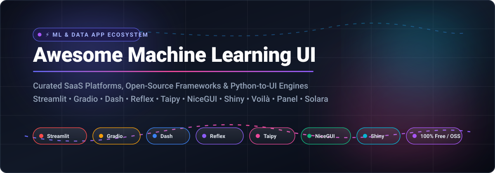

  

# 🚀 Awesome Machine Learning UI Frameworks

### 🌟 A Curated Directory of SaaS Platforms & Open-Source Python UI Builders for ML, Data Science & GenAI Applications

---

## 📌 Overview

**Awesome Machine Learning UI Frameworks** is an authoritative, community-driven catalog designed for **Data Scientists**, **Machine Learning Engineers**, **AI Researchers**, and **Full-Stack Python Developers**. 

As machine learning models and Generative AI applications evolve, the traditional friction of frontend development—HTML, CSS, React, and JavaScript state management—creates significant bottlenecks. The tools curated in this directory bridge that gap by converting raw Python scripts, Jupyter notebooks, and model inference pipelines into production-grade interactive web dashboards, LLM playgrounds, and data applications in minutes.

---

## 🧭 Table of Contents

- [📊 Sector Overview & Market Dynamics](#-sector-overview--market-dynamics)
- [☁️ SaaS & Hosted App Platforms](#-saas--hosted-app-platforms)
- [💻 Open-Source Frameworks & Libraries](#-open-source-frameworks--libraries)
- [🤝 How to Contribute](#-how-to-contribute)
- [💖 Support & Sponsorship](#-support--sponsorship)
- [📈 Star History](#-star-history)
- [⚠️ Disclaimer](#-disclaimer)

---

## 📊 Sector Overview & Market Dynamics

The global market for AI and machine learning platforms is projected to grow from **$18.2 Billion in 2024–2025 to over $70 Billion by 2026–2030**, compounding at an aggressive **CAGR of ~34%–38%**. Within this ecosystem, user interface layers and data app frameworks serve as critical enablers for operationalizing AI models and internal decision tools.

The sector exhibits **moderate fragmentation with emergent ecosystem consolidation**: while foundation giants (Snowflake via Streamlit, Hugging Face via Spaces) anchor dominant distribution channels for standard demos and enterprise warehousing, a diverse long-tail of innovative frameworks (Reflex, Taipy, NiceGUI, Solara) flourishes to solve specialized requirements such as multi-page reactive architectures, full-stack event dispatching, and high-performance real-time data streaming.

---

## ☁️ SaaS & Hosted App Platforms

The following hosted deployment environments and managed cloud platforms streamline sharing, hosting, and enterprise operationalization of Python ML apps. Sorted in descending order by **company scale (valuation / annual revenue)**:

| Product | Scale (Valuation / Revenue) | Description | Starting Pricing | Free Tier Limit |
| :--- | :--- | :--- | :--- | :--- |
| **[Streamlit Community Cloud](https://streamlit.io/cloud)** | **~$100B+ Valuation** *(Parent: Snowflake Inc., FY26 Rev ~$4.68B)* | Free managed hosting for Streamlit apps, tightly integrated with the Snowflake data cloud. | **100% Free** *(Enterprise via Snowflake Cortex)* | **Free forever**: Unlimited public apps + **1 private app** (0.078–2 vCPU, 690 MB–2.7 GB RAM, 50 GB storage; sleeps after 12h inactivity; no GPUs/custom domains). |
| **[Gradio (Hugging Face Spaces)](https://huggingface.co/spaces)** | **$4.5B+ Valuation** *(Estimated $100M+ ARR)* | Industry-standard hosting environment for model inference demos, LLM chat apps, and ML benchmarks. | **$7/month** *(Compute starting at $0.60/hr T4 GPU, $1.05/hr A10G)* | **Free forever**: Unlimited public Spaces on **CPU Basic** (2 vCPU, 16 GB RAM, 50 GB disk). Compute upgrades require PRO ($9/mo) or usage billing. |
| **[Retool](https://retool.com/)** | **$3.2B Valuation** *(Estimated ~$100M+ ARR)* | Enterprise internal app and dashboard builder featuring AI agent modules, SQL connectors, and GUI workflows. | **$10/builder/month** + $5/internal user/month *(Team plan)* | **Free forever**: Up to **5 users**, access to all database/API connectors, and **500 workflow runs/month**. |
| **[Posit Connect Cloud / shinyapps.io](https://posit.co/products/cloud/connect-cloud/)** | **$50M–$100M Revenue** *(Posit PBC / Certified B-Corp)* | Production deployment platform for Shiny, Streamlit, Dash, Quarto, and Python/R analytical reports. | **$13/month** *(Starter plan on shinyapps.io; $19/mo on Connect Cloud)* | **Free forever**: Up to **5 applications**, **20–25 active compute hours/month**, 1 GB–4 GB RAM, and community support. |
| **[Dash Enterprise (Plotly)](https://plotly.com/dash/)** | **~$18M–$20M Revenue** *(Plotly Inc.)* | Commercial deployment suite for Plotly Dash applications with enterprise SSO, Kubernetes scaling, and design tools. | **$29/seat/month** *($290/year Plotly Cloud Pro; custom for Enterprise)* | **Free trial**: **14-day free trial** with 10 Plotly credits, 1 creator seat, 3 private viewers, and 1 published Dash app. |
| **[Anvil](https://anvil.works/)** | **~$550K ARR** *(Anvil Works)* | Full-stack Python platform allowing developers to build drag-and-drop web frontends entirely in pure Python. | **$10/month** *(Hobby plan; billed annually or $14/month billed monthly)* | **Free forever**: **1 developer seat**, unlimited deployed apps on shared infrastructure, **50,000 data table rows**, 100 MB storage, and 30s task timeout. |
| **[Mercury Cloud](https://cosmicstack.ai/pricing)** | **~$750K ARR** *(MLJAR)* | Cloud runtime and notebook-sharing environment for interactive Mercury apps and AI agent automations. | **$19/month** *(Pro plan; $49/month Extended)* | **Free forever**: **$0/month** baseline tier with 5,000 credits/month, terminal agent pairing, and access to free-enabled AI models. |

---

## 💻 Open-Source Frameworks & Libraries

These open-source libraries enable you to build interactive machine learning interfaces and dashboards locally and deploy them on your own infrastructure without vendor lock-in. Sorted in descending order by **GitHub Stars**:

1. **[Streamlit](https://github.com/streamlit/streamlit)**   
   ⚡ **The fastest path from Python script to interactive web application.**  
   * **License**: Apache-2.0  
   * **Key Strengths**: Reruns script top-to-bottom on interaction without requiring manual state management boilerplate; massive ecosystem of third-party custom components; native charting with Altair, Plotly, and PyDeck.  
   * **Best For**: Rapid prototyping, exploratory data apps, internal analysis tools, and fast ML proof-of-concepts.

2. **[Gradio](https://github.com/gradio-app/gradio)**   
   🤖 **The universal standard for machine learning, multimodal, and Generative AI demos.**  
   * **License**: Apache-2.0  
   * **Key Strengths**: Effortless interface generation for inputs/outputs (audio, video, images, text, and dataframes); built-in WebSocket streaming, queue management, and native integration with Hugging Face Spaces.  
   * **Best For**: Multimodal model demonstrations, LLM chatbots, quick API client wrappers, and reproducible research demos.

3. **[Reflex](https://github.com/reflex-dev/reflex)**   
   🌐 **Pure Python full-stack web apps compiled directly to React and Next.js.**  
   * **License**: Apache-2.0  
   * **Key Strengths**: Write both frontend components and backend logic entirely in Python while generating standard React/Next.js client code; flexible state management with bi-directional WebSockets.  
   * **Best For**: Production-scale data web apps, complex internal portals, and full-stack SaaS prototypes requiring complete styling control.

4. **[Dash (Plotly)](https://github.com/plotly/dash)**   
   📈 **Enterprise-grade reactive web applications built on Flask, React, and Plotly.js.**  
   * **License**: MIT  
   * **Key Strengths**: Declarative callback architecture offering precise control over DOM elements, user events, and reactive state; background tasks with Celery/Redis; unparalleled interactive graphing capabilities.  
   * **Best For**: Production business intelligence, financial risk dashboards, and mission-critical enterprise analytics.

5. **[Taipy](https://github.com/Avaiga/taipy)**   
   🏎️ **High-performance data applications and scenario/pipeline management designed for production ML.**  
   * **License**: Apache-2.0  
   * **Key Strengths**: Built specifically to handle large datasets without client latency; native workflow pipeline scheduling and "what-if" scenario evaluation engines; dynamic pre-built UI components.  
   * **Best For**: Enterprise decision support systems, AI scenario comparisons, and production operational dashboards.

6. **[NiceGUI](https://github.com/zauberzeug/nicegui)**   
   🪄 **Gentle, versatile web-based user interface framework powered by FastAPI, Vue, and Quasar.**  
   * **License**: MIT  
   * **Key Strengths**: Super intuitive API for standard web widgets, 3D scene rendering, robotics control, and camera streams; automatic live-reloading during local development.  
   * **Best For**: Robotics interfaces, smart home dashboards, IoT controllers, and light-weight data science tools.

7. **[Voilà](https://github.com/voila-dashboards/voila)**   
   📓 **Instant conversion of Jupyter Notebooks into standalone, secure web applications.**  
   * **License**: BSD-3-Clause  
   * **Key Strengths**: Directly renders notebook markdown and outputs while completely suppressing raw code cells; executes widgets via the Jupyter interactive kernel (`ipywidgets`); zero frontend rewrite required.  
   * **Best For**: Sharing notebook findings with non-technical stakeholders without modifying source notebooks.

8. **[Panel (HoloViz)](https://github.com/holoviz/panel)**   
   🔬 **High-level app and dashboarding solution for the broader PyData and HoloViz ecosystem.**  
   * **License**: BSD-3-Clause  
   * **Key Strengths**: Seamless interoperability with Bokeh, Matplotlib, Altair, Plotly, and Datashader; effortlessly handles billions of data points through server-side downsampling.  
   * **Best For**: Scientific visualization, geospatial data exploration, and big data dashboards.

9. **[Mercury](https://github.com/mljar/mercury)**   
   ⚙️ **Turn Jupyter Notebooks into web apps and reports using simple YAML configuration headers.**  
   * **License**: Apache-2.0  
   * **Key Strengths**: Add interactive widgets (sliders, file pickers, text inputs) to standard notebooks via simple YAML frontmatter; built-in export to PDF/HTML and scheduled execution.  
   * **Best For**: Automated reporting, parameterized notebook executions, and scheduled analytical tasks.

10. **[Solara](https://github.com/widgetti/solara)**   
    🧩 **Pure Python, React-style component framework utilizing hooks for scalable state management.**  
    * **License**: Apache-2.0  
    * **Key Strengths**: Implements React-like paradigms (`use_state`, `use_effect`, component trees) directly in Python; executes both inside Jupyter notebooks and as standalone web applications.  
    * **Best For**: Large modular data science apps requiring systematic code organization and reusable component architecture.

11. **[Shiny for Python](https://github.com/posit-dev/py-shiny)**   
    🎯 **The proven reactive programming model from Posit, reimagined natively for Python.**  
    * **License**: MIT  
    * **Key Strengths**: Strict computational graph recalculation—only recalculates functions whose specific dependencies have changed, eliminating wasteful reruns; built-in WebAssembly (Shinylive) client-side execution.  
    * **Best For**: High-performance statistical dashboards, reactive enterprise analytics, and serverless client-side web apps.

12. **[Anvil Runtime](https://github.com/anvil-works/anvil-runtime)**   
    🛠️ **Open-source execution engine for self-hosting full-stack Anvil web applications.**  
    * **License**: AGPL-3.0  
    * **Key Strengths**: Complete freedom to self-host Anvil apps on private servers or Docker containers; eliminates cloud vendor lock-in while preserving Python-only architecture.  
    * **Best For**: On-premise enterprise deployments and air-gapped internal environments.

---

## 🤝 How to Contribute

Contributions are warmly welcomed! Please help maintain this list as the premier resource for machine learning UI frameworks:

1. 🍴 **Fork the repository** on GitHub.
2. 🌿 **Create a feature branch**: `git checkout -b feature/add-new-framework`
3. 📝 **Add or update the framework entry** following the existing alphabetical or tabular structure with accurate links, licensing, and pricing.
4. 📬 **Submit a Pull Request** with a concise summary of the addition or update.

*Ensure all submitted projects adhere to community standards and include accurate citations.*

---

## 💖 Support & Sponsorship

If you find this repository helpful for your projects, research, or company, please consider supporting its ongoing curation and development:

- ⭐ **Star this repository** to improve discoverability!
- 🍴 **Fork and share** it with fellow data scientists and ML practitioners!
- ☕ **Support the maintainer**: Buy a coffee or sponsor ongoing maintenance on the **[GitHub Sponsors Dashboard](https://github.com/sponsors/ishandutta2007)**!

Your support helps keep this ecosystem index fresh, accurate, and continuously updated. Thank you! 🙌

---

## 📈 Star History

---

## ⚠️ Disclaimer

- This catalog is a **community-curated index** provided for informational and educational purposes; inclusion does not constitute a formal commercial endorsement.
- Free hosting tiers are primarily suited for prototypes and demos: Streamlit Community Cloud hibernates apps after 12 hours of inactivity; Hugging Face Spaces free tiers utilize shared CPU clusters; shinyapps.io free tiers enforce monthly active-hour caps.
- Pricing metrics, tier structures, and resource allotments reflect vendor data as of **October 2026** and may fluctuate over time. Please verify current terms on official provider websites.

---

  Maintained with ❤️ by <a href="https://github.com/ishandutta2007">Ishan Dutta</a> and the open-source data science community.

